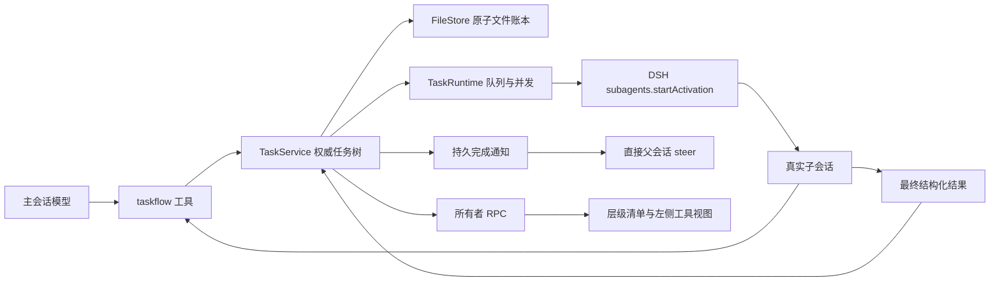
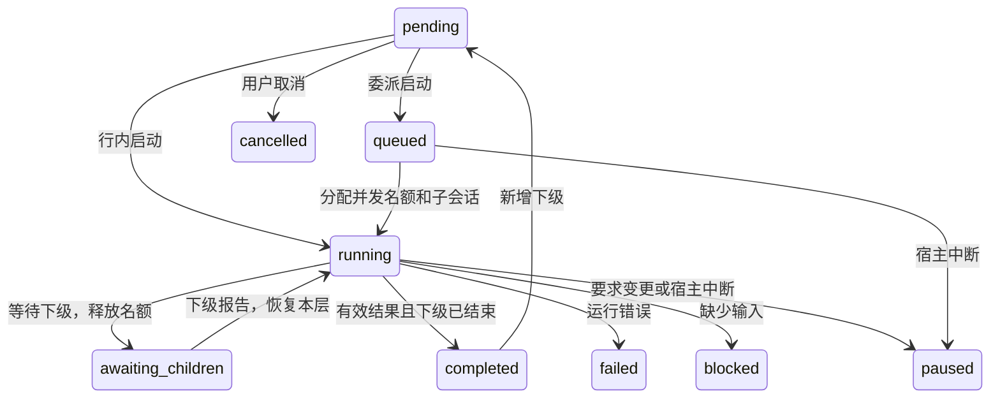

# 架构与工具协议

## 组件



`src/domain` 负责状态与归属规则；`src/application` 负责全树调度；`src/storage` 负责账本和事务；以上层无 DSH 依赖。`src/server` 分模块适配 rc.2 工具、配置、系统提示、Agent 事件、完成通知与所有者 RPC。`src/client` 使用会话槽位渲染导航，通过隔离 portal 展示左侧工具区。`scripts/dev` 是独立验收环境，不是生产入口。

## 数据和归属

`taskflow.json` 保存 schema、全局修订号、plans、会话到计划的映射与通知 outbox。一个计划包含稳定 UUID、根会话 ID、任务字典、各会话当前任务、工具视图、事件记录。任务采用递增 `T-001` ID，标题修改与同级排序不改变 ID。

任务父子关系与依赖关系分开建模。负责会话是直接父任务的执行会话；父任务尚未委派时向上回退到实际负责会话。行内任务复用负责会话；委派任务使用独立原生子会话，并在启动前持久化绑定。子会话只能改自己负责的子树，主会话可以操作整棵树。

任务版本描述当前要求，attempt UUID 描述一次执行。提交结果必须同时匹配两者及执行会话。更新要求会中止旧执行、递增版本；原报告和尝试号保留用于历史。完成后再增补下级会重新打开已完成祖先。取消保留记录和会话，不满足依赖的“已完成”条件。

## 状态



图仅列主要转换；所有未取消状态均可按约束更新、取消。父任务必须完成自身剩余工作才能提交结果，等待下级不构成额外审核。等待接口返回未启动的行内事项，模型继续处理，避免等待自己的工作而死锁。深度上限在启动时同步判定，转行内执行并在工具返回中告知模型。

## 模型工具

| 工具 | 参数与用途 |
| --- | --- |
| `taskflow_plan` | `title, goal, tasks`；仅首次创建，不覆盖已有计划 |
| `taskflow_status` | 读取完整计划、当前任务、版本与工具视图 |
| `taskflow_add` | `tasks, parentId?, expectedVersion?`；增补当前或指定任务 |
| `taskflow_update` | `taskId, version, patch`；增量修改要求、模式、归属、依赖 |
| `taskflow_cancel` | `taskId, version`；取消完整子树 |
| `taskflow_reorder` | `taskId, direction, expectedVersion`；同级上移 -1 / 下移 1 |
| `taskflow_start` | `taskId`；返回版本、模式、attempt 等实际执行信息 |
| `taskflow_wait` | `taskId`；释放本层委派名额，等待下级运行结束 |
| `taskflow_complete` | 行内任务提交 `taskId, version, attemptId, status?, summary` |
| `taskflow_open_view` | `kind, title?, url?, content?, filePath?, files?`；展示实际页面或文档 |

任务输入支持 `title / instructions / criteria / complexity / independent / mode / parentId / dependsOn`。同批次 `ref` 可用于父级与依赖引用，支持前向引用。`complexity` 为 low / medium / high，未指定模式时，中高复杂度且独立的任务委派，其他行内执行。`patch` 可修改 title、instructions、criteria、complexity、independent、mode、parentId、dependsOn；执行模式的变更需显式提供 mode。

委派任务最终必须通过 DSH 原生结构化输出提交：

```json
{ "status": "completed", "summary": "实际完成结果与可追溯证据" }
```

也可以返回 `blocked / failed`，不会勾选完成。没有有效结构化结果、宿主停止原因异常或下级未结束时，任务不会误报完成。

## 持久化和通知

所有修改串行事务执行；临时文件写入、fsync、rename 成功后才发布内存状态。单写入进程锁避免两个宿主同时覆盖。状态损坏会拒绝启动并保留原文件，不会用空状态覆盖。重启保留完成项，将中断任务暂停，不自动重跑。

完成状态与 outbox 同一事务提交。通知以计划、任务、版本、attempt 的组合去重；Agent 收件箱和会话历史中的确定消息 ID 再次去重，送达后 flush 会话。父会话不在线或持久化失败则保留重送；旧版本待送通知作废。此实现不承诺外部浏览器、终端命令的业务操作恰好执行一次，重试前需依据实际环境确认。

`taskflow_progress` 将模型给出的实际阶段进展写入当前任务的执行/记录子会话，校验当前执行归属及要求版本，不创建父级过程通知。行内工具结果按 toolCallId 绑定调用时的任务，防止切换事项后的迟到结果串写。最终完成通知发送前，先持久化子会话结果；记录失败保留 outbox 重试。直接父级为行内记录时，该父记录只追加最终完成摘要，负责执行的 Agent 仍按原通知链继续工作。

## 客户端与扩展

所有者专用 `/api` RPC：`taskflow/view`、`taskflow/action`。界面每 1.2 秒同步，不使用浏览器本地缓存作为权威数据。切换会话防止旧请求污染新视图，单次轮询不重叠。界面所有文本按 React 文本渲染，不解释 HTML。

原生 `sidebar.right.pane.tab` 槽位按注册定义 ID 挂载；头部入口使用 `conversation.session.header.utilities`。增补、修改、继续通过本会话输入 facade 预填并聚焦，用户发送后交给模型；取消和排序直接作为用户界面操作提交。

左侧工具 DOM 兼容层限定 rc.2 的 `[data-conversation-content]`、`data-conversation-session`、`data-content-phase`，只插入自己的节点和类名，不移动宿主内容。会话切换和卸载清理。没有目标节点时观察 DOM 等待出现，Hero 阶段不挤占布局。

可选注册专用工具渲染器：

```jsx
const dispose = ctx.taskflowViews.register('browser', ({ tool, sessionId }) => (
  <YourBrowserController taskId={tool.taskId} sessionId={sessionId} url={tool.url} />
));
```

渲染器的浏览器控制、权限与交互由对应插件负责。可按 `browser/editor/terminal/plugin` 注册非文档专用工具视图。识别文档后，`sidebarRight.openResource(address,{revealIfOpened:false})` 创建专用资源标签，通过 `float(tabId)` 保留宿主预览的完整作用域，恢复原面板焦点与展开状态。rc.2/rc.3 未提供文档预览 Factory，因此通过自身预览标签的原生 `data-sidebar-right-tab`、`data-dockkit-float` 标记，仅适配该浮层的视口位置、尺寸、层级与裁剪，使其呈现在工具面板内部；不重挂 DOM，不替换插件渲染器，不复用用户标签。目标移动/调宽/滚动同步更新，切会话或卸载通过 `closeIn(sessionId,tabId)` 只释放自己的资源。该布局适配依赖当前宿主 DOM，升级需重新做 UI 验收；宿主格式与权限仍由预览插件负责。网页使用 `sidebarRight.openTab('browser', {params:{url}})`。

任务入口依据任务面板 useTabInfo 的实际可见状态及公开侧栏接口切换；清单可见时收起，隐藏或正在显示其他页面时打开清单。嵌入文档获得浮层焦点不会改变清单实际可见判断。

`tools/execute` 读取 SDK 的 `exec.arguments`，展示执行态；`tools/result` 只读取最终接纳的真实结果，从明确路径字段识别文档。视图 ID 防止旧结果覆盖新操作，已关闭的视图不会被迟到结果重新打开。失败结果不触发文档或浏览器自动打开。终端生成但未返回路径的文档，由模型显式调用 `taskflow_open_view` 指定。

Markdown 与 Office/PDF 均不在 Taskflow 内读取或解码，读取授权、格式渲染和加载错误沿用宿主文档预览插件。打开器在声明注入 `sidebarRightTabs/sidebarRight/uiWorkspace` 的子作用域中创建，仅使用该作用域服务；不访问 `remote.workspaceFiles` 或 `documentPreviews`。缺少资源声明时显示插件未就绪及重试按钮。自动打开只发生于前台会话，按工具/会话/路径去重；异步反馈在目标变更或卸载后丢弃。页面打开与第三方自动化浏览器的状态共享不作保证，专用实时控制视图通过扩展注册接入。浏览器地址仍只接受不含凭据的 HTTP(S)。

任务清单和侧栏树共享真实任务状态，只有 running 显示旋转图标和“进行中”；等待与受阻不混同。执行状态由启动、委派、等待和完成事务更新，UI 点击不伪造执行状态。

### 原型样式来源

左侧树的 session-row/session-children、状态圆点和输入框上方快捷回复的 suggestions 规则也从原型生成，隔离到 Taskflow 自有节点；主会话只添加样式类和自己的图标/状态节点，不移走原生标题与操作菜单，卸载恢复原控件。

行内记录与执行归属分离：记录的 parentSession 是直接父事项的记录/委派会话，executionSessionId 仍表示真正执行的 Agent。只在 attempts>0 时首次创建记录，不因规划或增补预建会话；旧版未执行记录保留但不投影到侧栏。创建记录不启动 Agent。委派父级尚无实际会话时不平铺下级，实际开始后补建。完成记录保留原 attempt 的父地址，不因父级重试重复生成。

PlanningCheck 同时检查首轮规划与当前正在执行的中高复杂度事项。已有计划不再绕过子项检查；taskflow_assess 的 needsPlan 在此时表示是否需要下级，持久保存 decomposition.version/needsSplit/reason。判定需要拆解后必须实际 taskflow_add 落账才放行业务工具；已有下级逐项执行时递归检查。明确无需拆解的同版本判断在重载后仍有效；未落账的判断最多两次结束提醒、四个步骤后停止，避免无限重试。仅有模型判断权，不按关键词生成固定子任务。

快捷回复使用 conversation.input.dock 正式槽位，位于输入卡片上方，通过已认证 taskflow/action 的 quick-replies 读取。服务端调用当前模型的 llm.stream（purpose=taskflow.quick-replies），只传有限的最近文本和任务摘要，不提供工具、不进 Agent 收件箱、不更改任务。为推理和可见输出预留4096 tokens，60秒超时；分别处理max-tokens、认证、额度、格式与会话读取错误，不向客户端返回原始模型异常。上下文指纹去重，忙碌时取消旧生成；故障缓存至上下文变化或手动重试，卸载取消请求。冷会话读取原生request/header.header.config或model/selection恢复路由。点击通过 inputActions.insertText 的 draftRev 防冲突追加，保留引用和已有草稿。

`npm run build` 与开发服务启动时执行 `scripts/prd-assets.mjs`。脚本读取仓库内保留的 PRD，生成 `src/client/generated` 内的组件作用域 CSS、SVG 路径与 Fish 标志。完整宿主只注入这些组件样式，不注入原型的全局 app/sidebar/composer 规则。`styles.css` 负责宿主隔离、工具 portal 和断点适配。

验收外壳另以 `/prototype.css` 加载 PRD 的完整布局样式；`/prototype` 返回原始 PRD。外壳在窄屏通过区域标签切换，不改变宿主原有侧栏。任务详情在 document.body 使用原生模态 dialog，Escape、关闭按钮及遮罩外点击均可退出，避免把详情覆盖在右侧任务树内。
